  

### Hi there 👋

## Eduardo Rocha

I'm a fullstack engineer with a strong backend focus. I design modular APIs, care about clean boundaries, and ship products end-to-end — from domain modeling to UI and async workers.

I currently build **career & talent platforms** (candidate experience, job tracking, and AI-assisted resume/job matching), including work on **MTalent Match**: NestJS API, Next.js app, and a Python LLM worker behind Redis/BullMQ queues.

### What I work with

- **Backend:** Node.js, NestJS, TypeScript
- **AI / workers:** Python, BullMQ, structured LLM outputs (OpenAI / Claude / Gemini)
- **Architecture:** Domain-Driven Design, Clean Architecture, Ports & Adapters
- **Data:** PostgreSQL, Redis, SQL Server; object storage (S3-compatible)
- **Frontend:** React, Next.js (App Router)
- **Quality & security:** automated tests, httpOnly sessions, RBAC, input/upload hardening
- **Environment:** Linux-first workflow

I'm passionate about learning, building things that matter, and working with teams that value code quality, testing, and continuous improvement.

*“They didn’t know it was impossible, so they did it.”*

 

  
  

 

  <picture><source media="(prefers-color-scheme: dark)" srcset="assets/stats-dark.svg" /><source media="(prefers-color-scheme: light)" srcset="assets/stats.svg" /></picture>
  <picture><source media="(prefers-color-scheme: dark)" srcset="assets/langs-dark.svg" /><source media="(prefers-color-scheme: light)" srcset="assets/langs.svg" /></picture>

 

<picture>
  <source media="(prefers-color-scheme: dark)" srcset="assets/code-contribution-graph-dark.svg" />
  <source media="(prefers-color-scheme: light)" srcset="assets/code-contribution-graph.svg" />
  
</picture>
